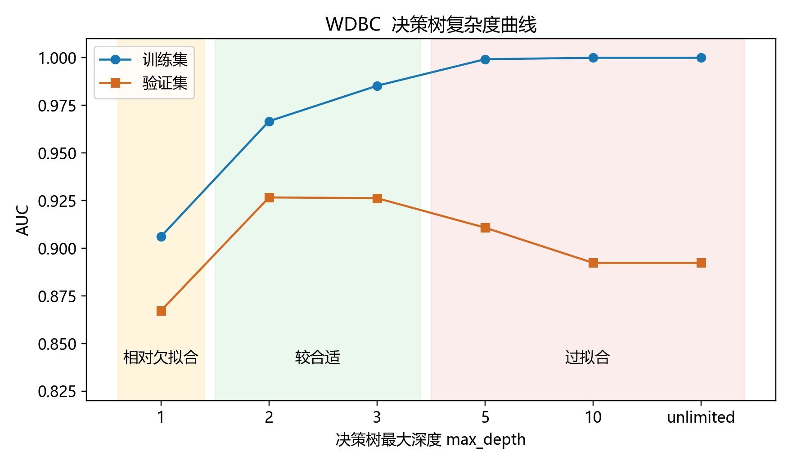
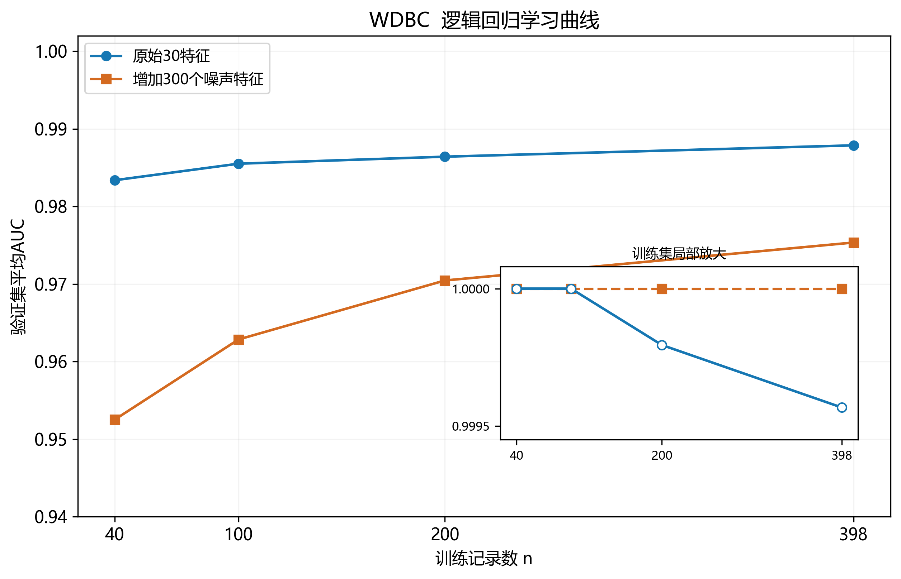
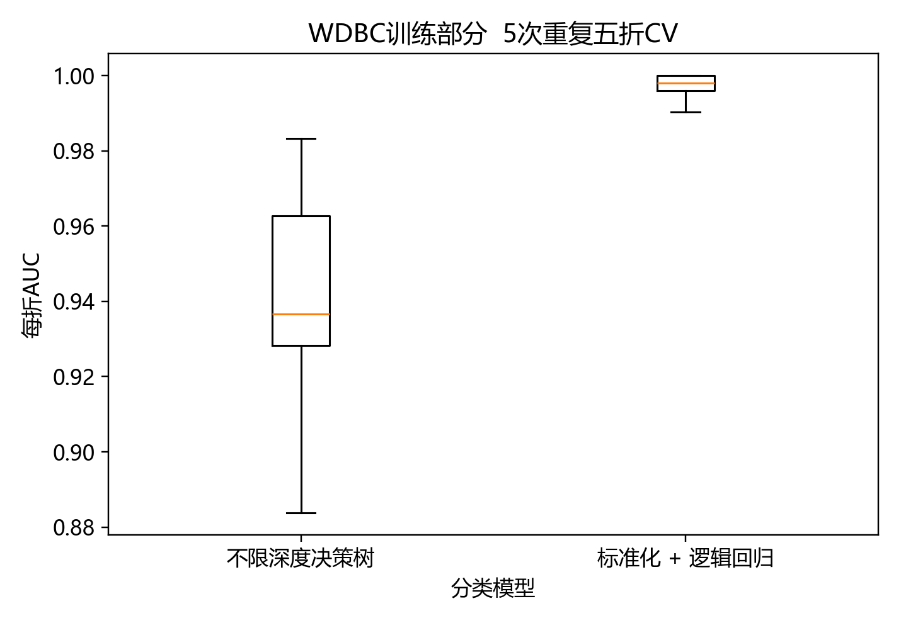
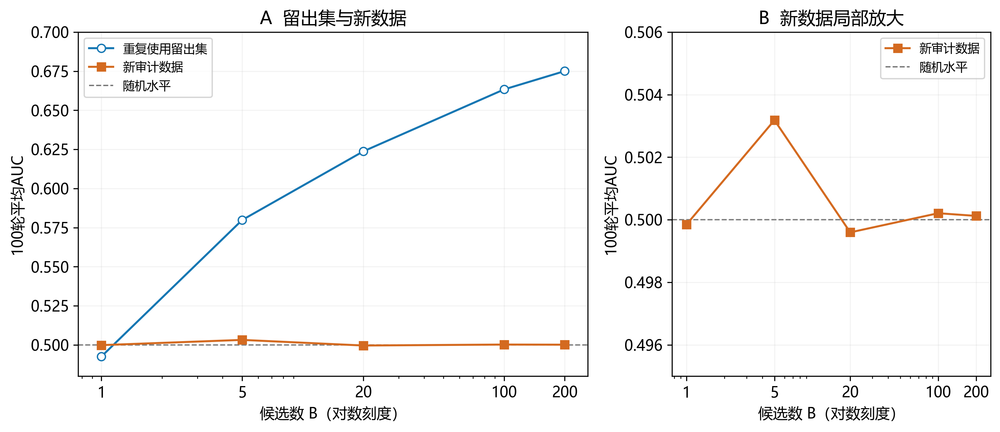
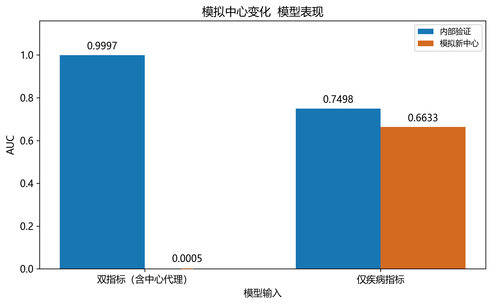
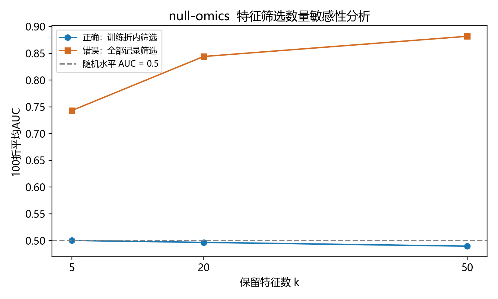
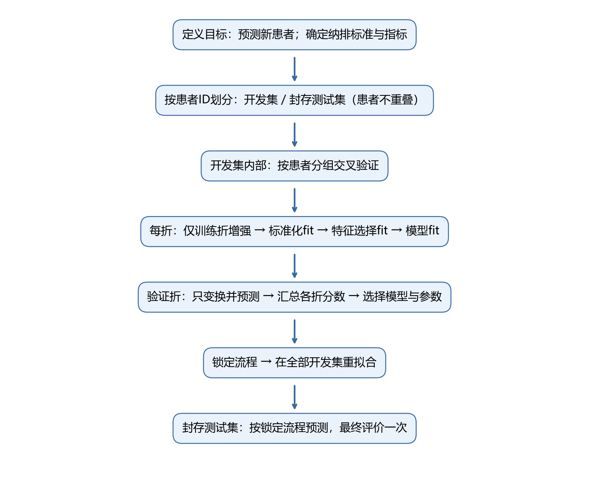

# 健康数据预测模型中的过拟合与评价偏差：七项对照实验及患者级验证流程设计

**Overfitting and Evaluation Bias in Health Data Prediction: Seven Controlled Experiments and a Patient-Level Validation Framework**

作者：________　小组：________　课程：健康大数据实践　日期：2026年11月25日

课程研究报告｜依据第11讲提供的数据与实验脚本完成

## 摘要

健康数据预测常面临样本量有限、特征维度较高及患者重复采样等情况，模型在内部数据上取得的高分未必能够推广至新患者。针对过拟合与评价偏差难以仅凭单一分数区分的问题，本研究基于WDBC乳腺肿瘤数据及教学模拟数据，开展七项对照实验，系统比较模型复杂度、样本量、无关特征、预处理范围、患者划分方式、重复模型选择和中心分布变化对预测表现的影响，并据此设计面向新患者的评价流程。结果表明，决策树由深度2增加至不限深度时，训练AUC升至1.0000，验证AUC却由0.9267降至0.8924；纯噪声数据采用全局特征筛选时，平均AUC为0.8441，改为折内筛选后为0.4964；按行划分与按患者划分的平均AUC分别为0.9867和0.4729。从200个随机候选中挑选出的模型在重复使用的留出集上达到0.6750，但在新数据上仅为0.5001。此外，模拟中心代理关系反转导致双指标模型AUC由0.9997降至0.0005。上述结果揭示了训练拟合、信息泄露、选择偏差与分布变化对评价结果的不同影响，为将折内预处理、患者级划分和独立测试集封存纳入模型评价流程提供了实验证据。

**关键词：**过拟合；信息泄露；患者分组；特征选择；选择偏差；分布变化

## 1 引言

乳腺肿块的良恶性鉴别是乳腺疾病诊断中的重要问题。出现可疑症状或影像异常后，临床通常需要结合进一步检查及活检结果明确诊断，病理与细胞学信息为判断病变性质提供依据。[3] 将细胞形态转化为定量指标，为研究辅助分类方法提供了数据基础。本研究使用的Wisconsin Diagnostic Breast Cancer（WDBC）数据来自乳腺肿块细针穿刺样本的数字化图像，特征描述细胞核的形态，包括半径、纹理、周长、面积等。[1] 因此，本研究的医学背景是基于细胞核形态特征的乳腺肿块良恶性分类，而非乳腺癌发病风险或生存预测。此类数据中的多维特征为分类提供信息，但一个样本内的多个指标并不等于多个独立患者；在重复采样场景中，能否推广至未见患者也不能仅由记录级评价判断。

机器学习通过从特征与诊断标签之间学习映射，为上述分类任务提供了计算方法。决策树通过逐级分裂表示非线性分类规则，逻辑回归通过特征的线性组合估计阳性概率，近邻方法则利用样本间距离完成预测。[5–7] 模型的灵活程度与可用样本、特征数量相互作用：模型可能未充分捕获结构而欠拟合，也可能拟合训练数据中的偶然波动而过拟合。更进一步，若标准化、特征筛选或候选模型选择使用了评价数据，或者同一患者的重复记录跨越训练与验证集合，较高分数还可能反映信息泄露或选择偏差。临床预测研究的TRIPOD报告规范强调区分模型开发与验证，并说明直接在开发数据上评价容易产生乐观估计。[4] 因而，对医学分类模型的分析需要同时检查模型本身、数据划分及完整评价流程。

围绕上述医学任务与计算问题，本研究基于老师提供的WDBC数据和教学模拟数据建立七项对照实验。首先，在WDBC固定训练与验证划分上改变决策树深度，比较训练和验证AUC，并通过不同样本量及增加300个噪声特征的逻辑回归实验考察高维小样本条件；随后，以重复五折交叉验证和逐例删除分析评价模型稳定性。其次，使用WDBC及纯噪声组学数据，分别比较标准化的拟合范围与特征筛选的位置，并在重复患者数据中比较记录级和患者级划分，以识别不同泄露机制。再次，以随机候选预测模拟重复挑选最高分造成的偏差，并构造中心代理关系反转的场景，区分模型选择问题与分布变化。最后，仅改变特征筛选数量开展敏感性分析，并综合实验结果，提出包含患者级划分、折内预处理、内部调参和封存测试集的新患者预测流程。研究目的在于解释评价分数的形成机制，并以可复现结果支持流程设计。

## 2 方法

### 2.1 数据来源与预测目标

WDBC包含569份样本、30个连续特征，其中恶性212份、良性357份，恶性记为阳性。使用课程预先指定的398条训练记录与171条验证记录，sample_id与split均不作预测特征。数据来源及特征定义依据UCI数据说明。[1]

null-omics包含180条记录与1000个噪声特征；每轮置换标签，以评价无信号条件下的特征筛选偏差。repeated-patients包含100位模拟患者，每人4条近似记录和40个指纹特征，标签按患者随机赋予。patient_id和visit不进入模型。E6、E7由老师脚本按固定种子生成；E7含疾病相关指标及原中心相关、在新中心反转的代理指标。

### 2.2 实验设计

| 实验 | 对照条件与重复方式 | 对应问题 |
| --- | --- | --- |
| E1-A | 决策树深度1、2、3、5、10及不限深度；固定训练/验证划分 | Q1 |
| E1-B | 标准化与逻辑回归；样本量40、100、200、398；0或300个噪声特征；重复10次 | Q2 |
| E2 | 决策树与逻辑回归共用5次重复五折CV；另逐次删除398条训练记录中的一条 | Q3 |
| E3 | 标准化fit使用全部569条或仅398条训练记录；逻辑回归C=0.1 | Q4 |
| E4 | 全局选择20特征后CV，或训练折内选择；20轮标签置换，每轮五折 | Q4 |
| E5 | 1近邻；按行分层随机划分或按患者分组划分；重复10次 | Q5 |
| E6 | 从1、5、20、100、200个随机候选中挑选；留出80条，新审计数据400条；重复100轮 | Q6 |
| E7 | 含中心代理或仅疾病指标；训练400条，内部及模拟新中心各200条 | Q7 |

补充分析仅改变E4的K_SELECT，由默认20改为5和50，其他条件保持一致。该分析检验筛选数量能否消除泄露产生的高分。

### 2.3 模块一 数据划分与预处理

总体数据流为“读入特征与标签 → 划分训练和评价记录 → 仅用训练部分拟合预处理 → 拟合分类器 → 输出阳性概率 → 计算并汇总指标”。各实验是并行对照，E1至E7并非串联的预测网络。记数据为D={(xᵢ,yᵢ)}，xᵢ为一条记录的特征向量，yᵢ∈{0,1}。训练、验证的角色在拟合前确定；患者级划分额外要求训练与评价患者ID集合不相交。

E1–E3读取课程既定WDBC划分。E2仅在398条训练记录内进行5次重复分层五折CV。E4每轮在180条记录内分层五折，每折144条训练、36条验证。E5分别按行分层随机划分，或用GroupShuffleSplit按患者ID划分，评价比例均为30%；后者按患者数量划分，不保证类别严格分层。

标准化在允许的训练记录集合T内估计每个特征的均值与尺度，再把相同变换用于评价记录。其形式为[8]：

$$ zᵢⱼ = (xᵢⱼ − μⱼ)/σⱼ， μⱼ = (1/nₜ)Σᵢ∈ₜ xᵢⱼ， σⱼ² = (1/nₜ)Σᵢ∈ₜ(xᵢⱼ − μⱼ)²。 （1） $$

其中nₜ为训练记录数，StandardScaler使用总体方差（ddof=0），与描述性统计中的样本标准差不同。E3仅改变T的范围以构造正确/泄露对照；其余使用Pipeline的实验由训练部分拟合该变换。近邻患者实验与决策树实验按原代码使用未标准化特征。

E4使用SelectKBest(f_classif)进行单变量筛选。对第j个特征，计算两类之间与类内的变异之比[9]：

$$ Fⱼ = {Σ꜀₌₀¹ n꜀(x̄꜀ⱼ − x̄ⱼ)²/(2−1)} / {Σ꜀₌₀¹Σᵢ:ᵧᵢ₌꜀(xᵢⱼ − x̄꜀ⱼ)²/(nₜ−2)}。 （2） $$

n꜀与x̄꜀ⱼ分别表示训练部分第c类的数量和该特征均值，x̄ⱼ为总体均值。代码按F得分保留k个特征，默认k=20，补充对照为5和50；不是用p值阈值筛选。正确顺序为“训练折内F筛选 → 标准化 → 逻辑回归”；错误流程先用全部记录及标签筛选，再进行CV。

### 2.4 模块二 分类器拟合与概率输出

**决策树。**E1-A与E2使用DecisionTreeClassifier，采用默认Gini准则及best分裂方式，random_state=1111。对节点t及候选左右子节点，代码所用准则可表示为[5]：

$$ G(t) = 1 − Σ꜀₌₀¹ pₜ꜀²， ΔG = G(t) − (nᴸ/nₜ)G(L) − (nᴿ/nₜ)G(R)。 （3） $$

pₜ꜀为节点内第c类比例，nᴸ、nᴿ为左右子节点记录数。算法选择使杂质下降最大的候选分裂；终端叶内阳性比例作为预测概率。E1-A只改变max_depth为1、2、3、5、10或None，E2使用不限深度树。

**逻辑回归。**E1-B、E2、E3、E4和E7使用LogisticRegression。设经过相应预处理后的向量为zᵢ，模型输出及等权样本下的优化目标为[6]：

$$ p̂ᵢ = 1/[1 + exp{−(β₀ + βᵀzᵢ)}]。 （4） $$

$$ minᵦ₀,ᵦ J = (1/nₜ)Σᵢ∈ₜ[−yᵢlog(p̂ᵢ) − (1−yᵢ)log(1−p̂ᵢ)] + ‖β‖₂²/(2Cnₜ)。 （5） $$

与所用scikit-learn 1.5.2设置一致，采用默认L2惩罚与lbfgs求解，截距不受该L2惩罚；C越小，惩罚越强。E3明确设置C=0.1，其余使用默认C=1。max_iter在E1-B为5000，E2–E4为2000，E7沿用默认100；它是迭代次数上限，不表示实际固定执行该次数。代码未使用类别权重或样本权重。

**1近邻。**E5使用KNeighborsClassifier(n_neighbors=1)，默认Minkowski距离参数p=2，等价于欧氏距离，且不作标准化[7]：

$$ i* = argminᵢ∈ₜ √[Σⱼ(xⱼ − xᵢⱼ)²]， p̂(y=1|x) = yᵢ*。 （6） $$

该模型直接使用最近训练记录的标签作为阳性概率（0或1）。患者内记录近乎相同，使它适于展示身份指纹跨集合后的重识别现象。

### 2.5 模块三 评价与扰动分析

分类器均通过predict_proba的阳性列得到分数，E6则使用随机连续分数。AUC按阳性与阴性分数的两两排序解释为[10]：

$$ AUC = (1/n₊n₋)Σᵢ:ᵧᵢ₌₁Σⱼ:ᵧⱼ₌₀[I(sᵢ>sⱼ) + 0.5I(sᵢ=sⱼ)]。 （7） $$

n₊、n₋为阳性、阴性记录数，I为指示函数。E1-A另记录accuracy_score；它来自predict产生的类别，而非AUC阈值优化。

E2的CV对决策树和逻辑回归使用同一组分层折，分别汇总25个AUC。删除分析仅针对决策树：先在全部398条训练记录上拟合基线，再依次去掉一条记录重拟合。在固定171条验证记录上计算：

$$ Δᵢ = (1/171)Σᵥ₌₁¹⁷¹ |p̂⁽⁻ⁱ⁾ᵥ − p̂⁽ᵃˡˡ⁾ᵥ|。 （8） $$

其中p̂⁽⁻ⁱ⁾与p̂⁽ᵃˡˡ⁾分别为删去第i条记录与基线模型的概率。按Δᵢ降序、训练索引升序选前三行，并列出删除后AUC和基线AUC。该操作为敏感性分析，不用于自动剔除病例。

结果按规定重复次数取算术均值。E2同时报告样本标准差（ddof=1）、最小值和最大值。未进行显著性检验或构造置信区间；重复CV折间共享记录，不视作独立研究。WDBC留出集参与本次模型比较，属于验证集。

### 2.6 模块四 重复选择与分布变化模拟

E6不训练任何分类器，而为200个候选生成独立于标签的随机分数。每轮对80条留出记录计算候选AUC，在前B个候选中选取最高者，再用对应候选对400条新记录的随机分数评价：

$$ b*(B) = argmax₁≤ᵦ≤ᴮ AUC(yᴴ,sᵦᴴ)， aᶠ(B) = AUC(yᶠ,sᵦ*⁽ᴮ⁾ᶠ)。 （9） $$

H表示重复使用的留出集，f表示新审计数据；B∈{1,5,20,100,200}，重复100轮。相同留出集在同一轮中用于多个B的比较，模拟选择机会增加的影响。

E7按cohort()生成两个指标，其中y为0或1：

$$ x疾病 = y + εᵈ， εᵈ∼N(0,1.2²)； x中心 = y + εˢ（原中心）或1−y + εˢ（新中心）， εˢ∼N(0,0.2²)。 （10） $$

训练、内部验证和模拟新中心的规模分别为400、200、200。对双指标和仅疾病指标两种输入，分别在训练数据拟合标准化与逻辑回归，再在内部和新中心评价。flip=True只改变中心代理与标签关系，模拟预测关联反转。Q8-A的数据增强和封存测试集流程属于实验后的设计方案，未在以上数据上实际实施。

### 2.7 可复现性

保留老师提供的输入CSV和实验函数，新增统一调用、汇总及作图脚本；输出集中于results目录。环境为Python 3.11.7、NumPy 1.26.4、pandas 2.2.3、scikit-learn 1.5.2、Matplotlib 3.9.2。数据哈希与完整依赖版本分别保存在environment.json和requirements-lock.txt。

## 3 结果

### 3.1 模型复杂度与训练—验证表现（Q1）

深度1的训练与验证AUC分别为0.9062和0.8673，均低于深度2–3，提示相对欠拟合。深度2的验证AUC最高，为0.9267。进一步增加深度时训练表现继续改善，验证表现下降；不限深度模型训练AUC为1.0000，验证AUC为0.8924。这一分离模式支持本次划分中存在过拟合。

**表1｜不同最大树深度的训练与验证表现。**

| 最大深度 | 训练AUC | 验证AUC | 训练准确率 | 验证准确率 |
| --- | --- | --- | --- | --- |
| 1 | 0.9062 | 0.8673 | 0.9271 | 0.8889 |
| 2 | 0.9667 | 0.9267 | 0.9698 | 0.9298 |
| 3 | 0.9853 | 0.9263 | 0.9749 | 0.9298 |
| 5 | 0.9992 | 0.9108 | 0.9925 | 0.8947 |
| 10 | 1.0000 | 0.8924 | 1.0000 | 0.8889 |
| unlimited | 1.0000 | 0.8924 | 1.0000 | 0.8889 |

*图1｜WDBC数据集上的决策树深度与预测表现。横轴为max_depth的六种离散设置，unlimited表示None；各设置使用相同398条训练、171条验证记录。蓝线为训练AUC，橙线为验证AUC；色带标示本次划分下的相对欠拟合、较合适与过拟合区域，非通用阈值。连线仅用于显示设置间趋势。*

### 3.2 样本量与无关特征（Q2）

所有条件的训练AUC介于0.9996和1.0000，而验证表现存在差异。增加300个噪声特征后，n=40时验证AUC由0.9834降至0.9525；n=398时由0.9879降至0.9754。噪声引起的差值从0.0309缩小至0.0125，符合增加有效样本可缓解高维噪声影响的预测。

**表2｜不同样本量与特征条件下的十次重复均值。**

| 训练样本量 | 噪声特征数 | 训练AUC | 验证AUC |
| --- | --- | --- | --- |
| 40 | 0 | 1.0000 | 0.9834 |
| 40 | 300 | 1.0000 | 0.9525 |
| 100 | 0 | 1.0000 | 0.9855 |
| 100 | 300 | 1.0000 | 0.9629 |
| 200 | 0 | 0.9998 | 0.9864 |
| 200 | 300 | 1.0000 | 0.9705 |
| 398 | 0 | 0.9996 | 0.9879 |
| 398 | 300 | 1.0000 | 0.9754 |

*图2｜WDBC数据集上逻辑回归的学习曲线。A为训练AUC，B为验证AUC；横轴为训练记录数，蓝色圆点线为原始30特征，橙色方点线为原始特征加300个独立高斯噪声特征。每点为10次重复的均值，使用相同171条验证记录；未绘制置信区间。n=398时无噪声组每轮使用相同训练记录。*

### 3.3 交叉验证波动与个案敏感性（Q3）

决策树CV标准差为0.0251，约为逻辑回归0.0027的9.45倍。删除训练索引69的记录后，验证概率平均绝对变化为0.1170，验证AUC从0.8924变为0.9173。折间波动和个案敏感性共同提示决策树具有较高方差；它们不能直接证明对应记录错误。

**表3｜两个模型各25折AUC的描述性统计。**

| 模型 | 折数 | 均值 | 标准差 | 最小值 | 最大值 |
| --- | --- | --- | --- | --- | --- |
| logistic | 25 | 0.9975 | 0.0027 | 0.9903 | 1.0000 |
| tree | 25 | 0.9415 | 0.0251 | 0.8838 | 0.9833 |

**表4｜验证概率变化最大的三次删除分析。索引为训练数组中的零起始位置。**

| 删除训练索引 | 平均绝对概率变化 | 删除后验证AUC | 基线验证AUC |
| --- | --- | --- | --- |
| 69 | 0.1170 | 0.9173 | 0.8924 |
| 63 | 0.1111 | 0.9095 | 0.8924 |
| 153 | 0.1111 | 0.9251 | 0.8924 |

*图3｜WDBC训练部分上两种模型的交叉验证AUC分布。横轴为不限深度决策树及标准化后的逻辑回归，纵轴为AUC；每组包含5次重复五折CV的25个分数。箱体为第25至75百分位，中线为中位数，须延伸至1.5倍四分位距内最远观测，圆点为超出须的观测。两模型共用折划分，折间结果相关，本图仅作描述性展示。*

### 3.4 标准化与特征筛选的信息边界（Q4）

E3中，全部数据标准化与仅训练数据标准化的AUC分别为0.9867和0.9876，差异为−0.0009。E4中，全局筛选与正确折内筛选的100折均值分别为0.8441和0.4964，差异为0.3477。泄露的影响取决于机制与数据；本次标准化泄露并未提高分数，而使用验证标签筛选产生了明显乐观结果。

**表5｜错误与正确预处理流程的比较。**

| 实验 | 错误流程AUC | 正确流程AUC | 不当使用的信息 |
| --- | --- | --- | --- |
| E3 标准化 | 0.9867 | 0.9876 | 验证特征进入均值与标准差估计 |
| E4 特征筛选 | 0.8441 | 0.4964 | 验证折标签进入全局特征选择 |

E3错误StandardScaler.fit使用全部569条特征记录，正确流程仅使用398条训练记录；两者分类器均只使用训练记录和标签。E4错误SelectKBest.fit_transform使用全部180条记录及标签，之后的每折标准化和分类器虽仅用144条训练记录，仍无法消除筛选阶段的泄露。正确流程每折在144条训练记录内完成筛选、标准化与分类器拟合，其余36条记录只用于变换和预测。

### 3.5 按患者划分与身份重识别（Q5）

按行划分的平均AUC为0.9867，平均重叠74.9位患者；按患者划分没有交叉重叠，AUC为0.4729。尽管patient_id未作为特征，近似的患者指纹仍可跨集合传播，说明去除ID列不能替代患者级划分。74.9是十次重复的均值。

**表6｜患者划分方式与评价结果。**

| 方法 | 平均AUC | 平均重叠患者数 |
| --- | --- | --- |
| group_split | 0.4729 | 0.0000 |
| row_split_leaky | 0.9867 | 74.9000 |

### 3.6 重复选择引起的乐观评价（Q6）

候选数从1增至200时，被重复使用的留出集AUC由0.4926升至0.6750，而新审计数据均值保持在0.5附近，200候选时为0.5001。候选均为随机预测，因此留出分数的增长来自选择机会的增加。

**表7｜不同候选预算下100轮模拟的平均AUC。**

| 候选数 | 重复使用留出集AUC | 新数据AUC |
| --- | --- | --- |
| 1 | 0.4926 | 0.4998 |
| 5 | 0.5798 | 0.5032 |
| 20 | 0.6237 | 0.4996 |
| 100 | 0.6633 | 0.5002 |
| 200 | 0.6750 | 0.5001 |

*图4｜随机预测模拟中候选数量与选择偏差的关系。横轴为每轮可供选择的候选数，纵轴为100轮平均AUC。蓝色圆点线为80条重复使用留出记录上的赢家分数，橙色方点线为同一赢家在400条新审计记录上的分数；灰色虚线为AUC=0.5。各候选分数均与标签独立，未绘制置信区间。*

### 3.7 模拟中心变化与预测关系反转（Q7）

双指标模型内部AUC为0.9997，在中心代理关系反转后降至0.0005；仅疾病指标模型分别为0.7498和0.6633。前者在新中心几乎反向排序。AUC低于0.5表示随机配对的阳性记录获得更高预测分数的概率低于一半，并列计半。

**表8｜内部与模拟新中心AUC。both_markers含中心代理，biological_only仅含疾病指标。**

| 模型 | 内部AUC | 模拟新中心AUC |
| --- | --- | --- |
| biological_only | 0.7498 | 0.6633 |
| both_markers | 0.9997 | 0.0005 |

*图5｜模拟中心关系反转时两种输入模型的AUC。横轴为含疾病与中心代理的双指标模型和仅疾病指标模型；蓝柱为内部验证，橙柱为模拟新中心，每个集合200条记录。模型均在400条原中心记录上拟合。新中心中代理指标与标签的关系反转；柱高为一次固定种子模拟的AUC，无误差条。*

### 3.8 特征筛选数量的敏感性分析

当k为5、20、50时，正确流程平均AUC分别为0.5001、0.4964、0.4894，错误流程分别为0.7429、0.8441、0.8818。无论筛选数量如何，正确流程均接近随机水平，错误流程均表现乐观。本次错误分数随k上升，但不能将该单调关系推广至所有数据。

**表9｜改变保留特征数后的AUC汇总，各条件100折。**

| 特征数k | 流程 | 折数 | 平均AUC | 标准差 |
| --- | --- | --- | --- | --- |
| 5 | fold_pipeline | 100 | 0.5001 | 0.0937 |
| 5 | global_selection_leaky | 100 | 0.7429 | 0.0775 |
| 20 | fold_pipeline | 100 | 0.4964 | 0.1025 |
| 20 | global_selection_leaky | 100 | 0.8441 | 0.0726 |
| 50 | fold_pipeline | 100 | 0.4894 | 0.1109 |
| 50 | global_selection_leaky | 100 | 0.8818 | 0.0535 |

*图6｜null-omics纯噪声数据上的特征筛选数量敏感性分析。横轴为保留特征数k（5、20、50），纵轴为20轮五折CV共100折的平均AUC。蓝色圆点线表示正确折内筛选，橙色方点线表示错误全局筛选；灰色虚线为随机水平0.5。其余数据、种子、划分与逻辑回归设置相同，未绘制置信区间。*

## 4 讨论

### 4.1 高分产生的不同机制

E1揭示了拟合复杂度与泛化表现的分离：欠拟合表现为可学习结构未被充分捕获，过拟合表现为训练改善伴随验证恶化。E2支持同时检查折间波动与个案敏感性，而非只看平均分数。E1-B说明训练AUC接近1仍可能掩盖高维噪声对验证表现的损害。

E4的高分来自验证信息进入筛选，E5的高分来自同一患者跨集合，E6的高分来自反复选择。它们破坏评价独立性的机制不同。E7则明确构造了预测关系的分布变化；不能仅凭外部掉分认定是同分布条件下的训练过拟合。

### 4.2 评价流程的实践含义

需要fit的步骤都应限制在相应训练部分。五折CV中可用SelectKBest、StandardScaler和LogisticRegression组成Pipeline，在每个训练折重新拟合，验证折只变换与预测。若采用数据增强，应先按患者或原样本划分，再只增强训练折；普通Pipeline不会自动保证增强副本不跨集合。

影响最大的病例需依据原始记录与预设质量标准核查，不能因为删除后验证分数更高而删掉。若用验证集选择删哪些病例，该集合已参与选择。重复挑选最高AUC与多重检验后只报告最小p值具有相同的选择偏差风险。

若目标改为预测同一患者未来结局，评价应按时间顺序组织，明确输入和结局窗口，防止未来信息进入模型。对于外部掉分，应检查病例构成、设备、测量尺度、纳排标准、结局定义、标签质量、缺失处理和预处理实现，并结合样本量和评价不确定性分析。

### 4.3 新患者预测的流程设计（Q8-A）

首先明确结局、预测时点和纳排标准，按患者ID划分开发集与封存测试集，同一患者的所有重复采样及增强后代均归入同侧。开发集内部采用患者分组CV；每折仅对训练患者增强，并在该训练折拟合标准化、特征选择及模型。

各候选模型和参数使用相同分组方案，对未增强验证患者预测并汇总指标，选择模型与参数。锁定全部流程及必要阈值后，在全部开发数据上重拟合。封存测试集仅用于锁定后的最终评价一次；若据其分数继续修改，应另行取得独立评价数据。

E5支持患者级划分，E3–E4支持折内预处理，E6支持测试集封存。E7提示在跨中心部署前应另行安排真实外部验证。

*图7｜面向新患者的模型开发与评价流程设计。箭头表示处理先后顺序：患者级初始划分后，在开发集内部按患者分组CV；每折仅训练部分增强并拟合预处理和模型，验证部分只变换及预测；锁定设置后重拟合，最终对封存测试患者评价一次。本图为方法设计示意，无数值坐标，未在本研究数据上实际执行完整流程。*

### 4.4 局限性

本报告是以机制演示为目的的教学研究。除WDBC外，其余场景为模拟；单一数据集、固定划分及人为中心关系反转限制了结论的临床推广。WDBC未提供患者与中心分组字段，无法在该数据上实际验证Q8设计的完整患者级多中心流程。

重复CV的折间结果相关，未给出独立重复研究意义上的置信区间。本次未进行真实外部验证，也未评价临床效益与部署安全性。预测文本由本次协助在运行前记录，不是学生此前独立预注册的假设。上述限制不影响对本次对照机制的描述，但限制其外推范围。

## 5 结论

七项实验显示，训练拟合、评价独立性和部署环境稳定性共同影响对模型性能的判断。减少泄露、按患者组织划分、将预处理与选择限制在开发数据内部，并在锁定流程后评价独立数据，能够使预测分数更接近其实际含义。内部高分仍需结合数据来源与分布变化解释。

## 数据与代码可用性

输入数据保存在data目录；老师原实验脚本为scripts/run_experiments.py，统一运行脚本为scripts/complete_assignment.py。原始结果位于results/baseline，汇总表位于results/tables，图位于results/figures；修改条件结果另存于results/variation-k5与results/variation-k50。run_assignment.ps1提供本机重跑入口。全部结果目前保存在本地，尚无公开代码仓库地址。

## 参考资料

1. Wolberg W, Mangasarian O, Street N, Street W. Breast Cancer Wisconsin (Diagnostic). UCI Machine Learning Repository. DOI: 10.24432/C5DW2B. https://archive.ics.uci.edu/dataset/17/breast+cancer+wisconsin+diagnostic
2. 第11讲课程材料：《欠拟合与过拟合的识别》，student-worksheet.md、experiment-design.md及scripts/run_experiments.py，教师随作业提供。

3. National Cancer Institute. How Breast Cancer Is Diagnosed. https://www.cancer.gov/types/breast/diagnosis
4. Collins GS, Reitsma JB, Altman DG, Moons KGM. Transparent reporting of a multivariable prediction model for individual prognosis or diagnosis (TRIPOD): the TRIPOD statement. BMJ. 2015;350:g7594. DOI: 10.1136/bmj.g7594.
5. scikit-learn 1.5.2 documentation. Decision Trees. https://scikit-learn.org/1.5/modules/tree.html
6. scikit-learn 1.5.2 documentation. Linear Models: Logistic regression. https://scikit-learn.org/1.5/modules/linear_model.html#logistic-regression
7. scikit-learn 1.5.2 documentation. KNeighborsClassifier. https://scikit-learn.org/1.5/modules/generated/sklearn.neighbors.KNeighborsClassifier.html
8. scikit-learn 1.5.2 documentation. StandardScaler. https://scikit-learn.org/1.5/modules/generated/sklearn.preprocessing.StandardScaler.html
9. scikit-learn 1.5.2 documentation. f_classif. https://scikit-learn.org/1.5/modules/generated/sklearn.feature_selection.f_classif.html
10. scikit-learn 1.5.2 documentation. roc_auc_score. https://scikit-learn.org/1.5/modules/generated/sklearn.metrics.roc_auc_score.html

## 补充材料S1：工作单问题与论文位置

| 工作单要求 | 对应位置 |
| --- | --- |
| Q1 复杂度、定义与证据 | 3.1、图1、表1及4.1 |
| Q2 学习曲线、训练/验证均值 | 3.2、图2及表2 |
| Q3 波动、删除前三例及是否删数据 | 3.3、表3–4、图3及4.2 |
| Q4 fit范围、泄露机制及Pipeline | 3.4、表5及4.2 |
| Q5 分组、增强与未来预测 | 3.5、表6及4.2 |
| Q6 选择偏差与多重检验 | 3.6、图4、表7及4.2 |
| Q7 中心变化及掉分原因 | 3.7、图5、表8及4.2 |
| 修改至少一个实验条件 | 2.2、3.8、表9及图6 |
| Q8-A 流程设计 | 4.3及图7 |

## 补充材料S2：实验前预测与概念小结

| 问题 | 运行前记录的预测 |
| --- | --- |
| Q1 | 树加深改善训练表现，验证表现可能先升后降。 |
| Q2 | 少样本与增加噪声特征会降低验证AUC；更多样本减小差距。 |
| Q3 | 决策树CV波动大于逻辑回归。 |
| Q4 | 全局筛选在无信号数据上虚高，折内流程均值接近0.5。 |
| Q5 | 按行划分高于按患者划分；后者接近随机。 |
| Q6 | 200个随机候选中的赢家在新数据上仍接近0.5。 |
| Q7 | 中心代理关系反转后，双指标模型明显恶化。 |
| 修改条件 | k为5、20、50时错误流程仍虚高，正确流程接近0.5；不预设随k单调变化。 |

| 核心概念 | 解释 | 数字例子 |
| --- | --- | --- |
| 泛化与数据角色 | 训练拟合，验证选择，测试最终评价；泛化涉及未参与选择的新对象。 | E6赢家留出/新数据AUC为0.6750/0.5001。 |
| 欠拟合与过拟合 | 前者结构未学充分，后者学入训练特有波动。 | E1不限深度训练/验证AUC为1.0000/0.8924，深度2验证为0.9267。 |
| 原因与征兆 | 样本少、无关特征多、复杂度高增加风险，折间波动提供证据。 | 树与逻辑回归CV标准差为0.0251/0.0027。 |
| 信息泄露 | 评价数据进入拟合或选择，破坏评价独立性。 | E4错误/正确AUC为0.8441/0.4964。 |
| 选择偏差与分布变化 | 反复选择使成绩乐观，数据关系变化使内部优势失效。 | E7双指标内部/新中心AUC为0.9997/0.0005。 |
