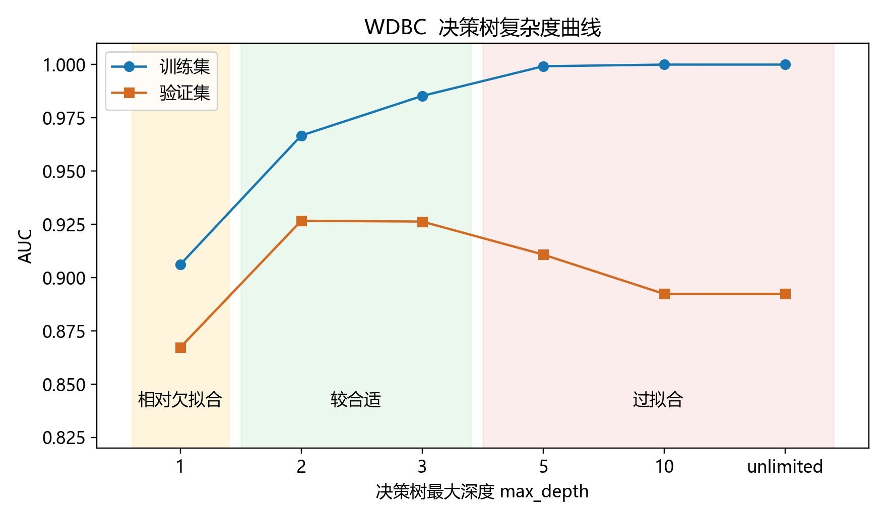
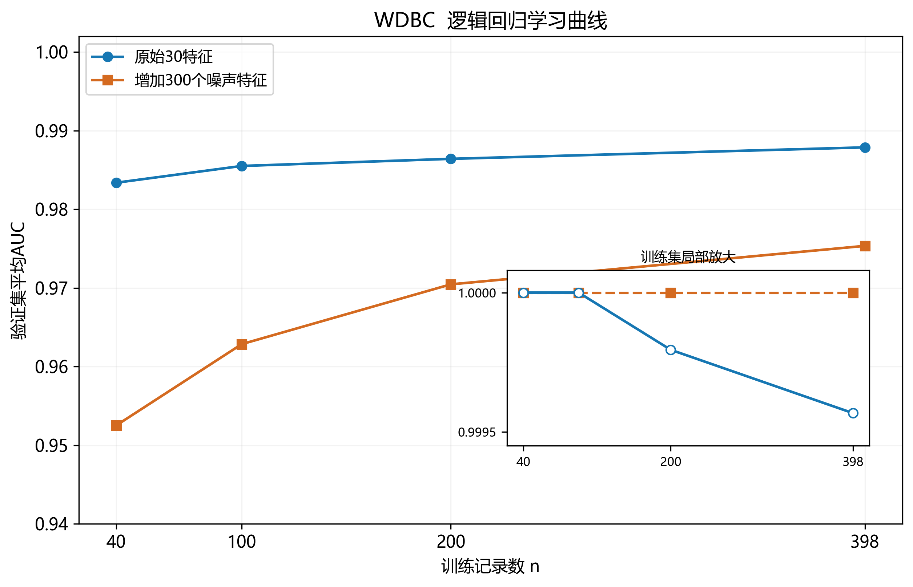
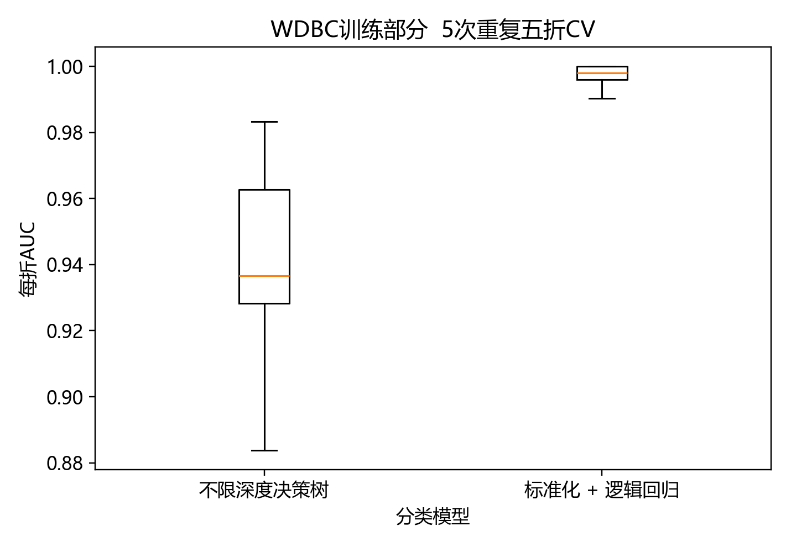
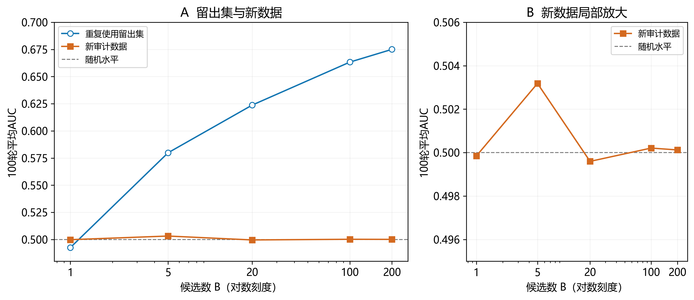
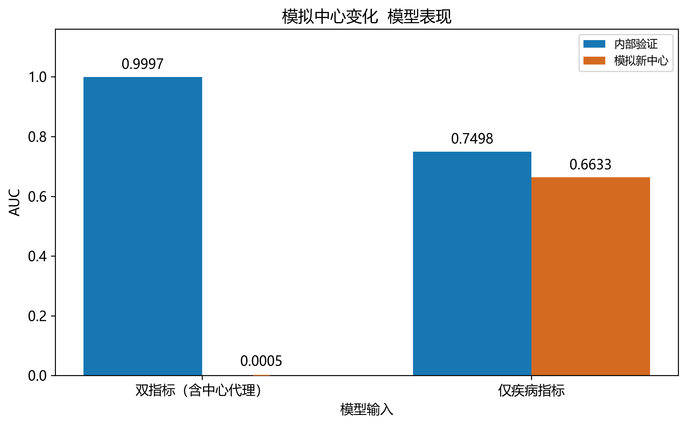
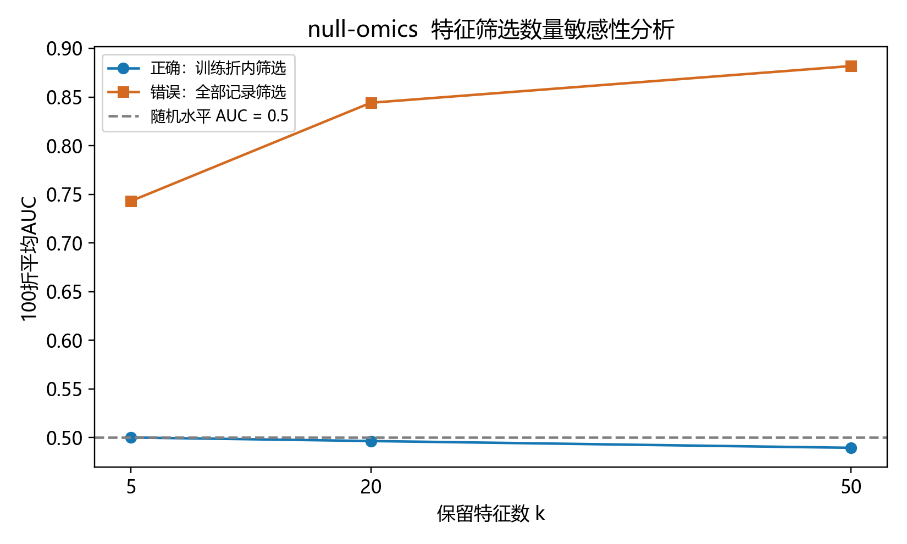
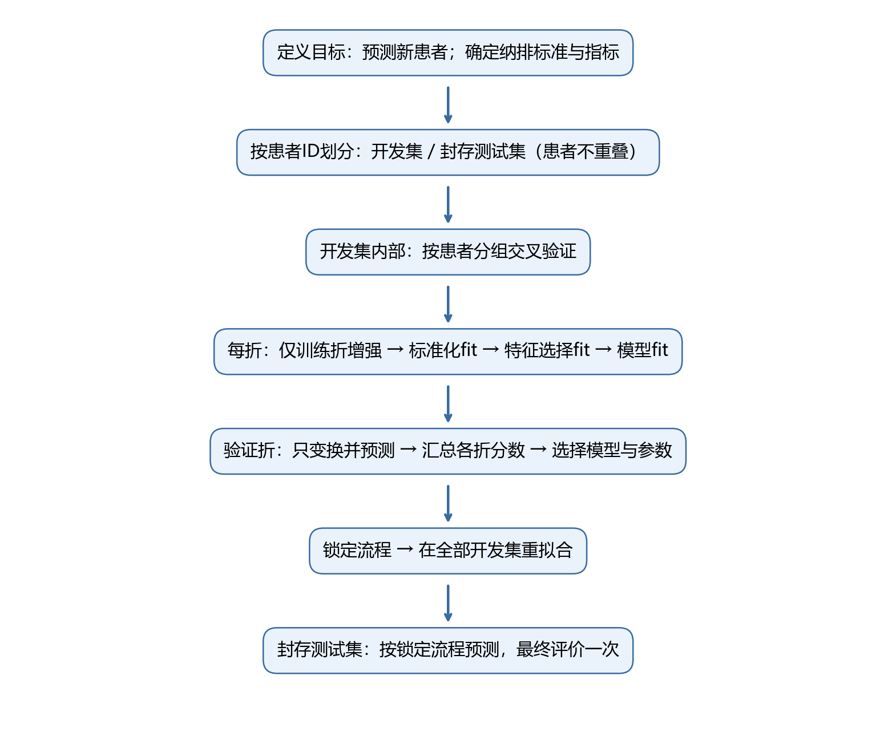

# 健康数据预测模型中的过拟合与评价偏差：七项对照实验及患者级验证流程设计

**Overfitting and Evaluation Bias in Health Data Prediction: Seven Controlled Experiments and a Patient-Level Validation Framework**

作者：王梦晴

## 摘要

健康数据预测常面临样本量有限、特征维度较高及患者重复采样等情况，模型在内部数据上取得的高分未必能够推广至新患者。针对过拟合与评价偏差难以仅凭单一分数区分的问题，本研究基于 WDBC 乳腺肿瘤数据及仿真数据，开展七项对照实验，系统比较模型复杂度、样本量、无关特征、预处理范围、患者划分方式、重复模型选择和中心分布变化对预测表现的影响，并据此设计面向新患者的评价流程。结果表明，决策树由深度 2 增加至不限深度时，训练 AUC 升至 1.0000，验证 AUC 却由 0.9267 降至 0.8924；纯噪声数据采用全局特征筛选时，平均 AUC 为 0.8441，改为折内筛选后为 0.4964；按行划分与按患者划分的平均 AUC 分别为 0.9867 和 0.4729。从 200 个随机候选中挑选出的模型在重复使用的留出集上达到 0.6750，但在新数据上仅为 0.5001。此外，模拟中心代理关系反转导致双指标模型 AUC 由 0.9997 降至 0.0005。上述结果揭示了训练拟合、信息泄露、选择偏差与分布变化对评价结果的不同影响，为将折内预处理、患者级划分和独立测试集封存纳入模型评价流程提供了实验证据。

**关键词：**过拟合；信息泄露；患者分组；特征选择；选择偏差；分布变化

## 1 引言

乳腺肿块的良恶性鉴别是乳腺疾病诊断中的重要问题。出现可疑症状或影像异常后，临床通常需要结合进一步检查及活检结果明确诊断，病理与细胞学信息为判断病变性质提供依据。[2] 将细胞形态转化为定量指标，为研究辅助分类方法提供了数据基础。本研究使用的 Wisconsin Diagnostic Breast Cancer（WDBC）数据来自乳腺肿块细针穿刺样本的数字化图像，特征描述细胞核的形态，包括半径、纹理、周长、面积等。[1] 本研究聚焦于基于细胞核形态定量特征的乳腺肿块良恶性分类，考察此类医学表型数据在模型评价中的泛化问题。此类数据中的多维特征为分类提供信息，但一个样本内的多个指标并不等于多个独立患者；在重复采样场景中，能否推广至未见患者也不能仅由记录级评价判断。

机器学习通过从特征与诊断标签之间学习映射，为上述分类任务提供了计算方法。决策树通过逐级分裂表示非线性分类规则，逻辑回归通过特征的线性组合估计阳性概率，近邻方法则利用样本间距离完成预测。[7] 模型的灵活程度与可用样本、特征数量相互作用：模型可能未充分捕获结构而欠拟合，也可能拟合训练数据中的偶然波动而过拟合。更进一步，若标准化、特征筛选或候选模型选择使用了评价数据，或者同一患者的重复记录跨越训练与验证集合，较高分数还可能反映信息泄露或选择偏差。临床预测研究的 TRIPOD 报告规范强调区分模型开发与验证，并说明直接在开发数据上评价容易产生乐观估计。[3] 高维组学研究已指出全局特征筛选会使误差评价偏乐观，[4] 模型选择本身也可能适应评价样本中的随机波动。[5,6] 泄露风险因此需要沿数据处理与评价的完整流程检查。[8]

围绕上述医学任务与计算问题，本研究采用 WDBC 基准数据集和仿真数据集开展七项对照实验。首先，在 WDBC 固定训练与验证划分上改变决策树深度，比较训练和验证 AUC，并通过不同样本量及增加 300 个噪声特征的逻辑回归实验考察高维小样本条件；随后，以重复五折交叉验证和逐例删除分析评价模型稳定性。其次，使用 WDBC 及纯噪声组学数据，分别比较标准化的拟合范围与特征筛选的位置，并在重复患者数据中比较记录级和患者级划分，以识别不同泄露机制。再次，以随机候选预测模拟重复挑选最高分造成的偏差，并构造中心代理关系反转的场景，区分模型选择问题与分布变化。最后，仅改变特征筛选数量开展敏感性分析，并综合实验结果，提出包含患者级划分、折内预处理、内部调参和封存测试集的新患者预测流程。研究目的在于解释评价分数的形成机制，并以可复现结果支持流程设计。

## 2 方法

### 2.1 数据与研究设计

本研究采用一个真实基准数据集和四类仿真场景。WDBC 包含 569 份乳腺肿块样本与 30 个细胞核形态特征，其中恶性 212 份、良性 357 份，恶性记为阳性。[1] 使用预先固定的分层划分：训练 398 份、验证 171 份。样本编号、诊断标签与划分标记均不进入特征矩阵。

纯噪声组学数据包含 180 条记录与 1000 个独立高斯噪声特征；每轮重新置换随机标签。重复患者数据包含 100 位模拟患者，每位患者有 4 条近似记录及 40 个指纹特征，标签按患者随机赋予。患者标识与访视编号仅用于组织数据。重复选择场景以独立随机分数表示候选预测；中心变化场景则构造一个疾病相关指标和一个关系可反转的中心代理指标。各场景的核心参数和控制变量见表 A。

**表 A 主要实验的对照逻辑与参数设置**

| 研究环节 | 控制变量与模型 | 数据划分及重复方式 |
| --- | --- | --- |
| 模型复杂度 | 决策树最大深度为 1、2、3、5、10 或不限 | WDBC 固定训练与验证划分 |
| 样本量与噪声 | 标准化后逻辑回归，正则化参数 $C=1$；训练量 $n=40,100,200,398$；增加 0 或 300 个噪声特征 | 每个条件重复 10 次，验证记录固定 |
| 模型稳定性 | 不限深度树与标准化后逻辑回归（$C=1$）；另对树逐例删除训练记录 | 训练集内 5 次重复分层五折；另重拟合 398 次 |
| 标准化范围 | 逻辑回归固定 $C=0.1$；比较全体记录或仅训练记录估计标准化参数 | WDBC 固定划分，仅改变标准化范围 |
| 特征筛选位置 | 单变量 F 检验保留 $k=20$ 个特征；标准化后逻辑回归，$C=1$ | 全局筛选后分层五折，对照训练折内筛选；20 轮 |
| 患者划分 | 原始指纹特征上的 1 近邻；记录级划分对照患者级划分 | 每次验证比例为 30%，重复 10 次 |
| 重复选择 | 随机候选数 $B=1,5,20,100,200$ | 每轮留出 80 条、新审计 400 条，重复 100 轮 |
| 中心变化 | 标准化后逻辑回归，$C=1$；双指标对照仅疾病指标 | 训练 400 条、内部验证 200 条、新中心 200 条；新中心代理关系反转 |

标准化对照将正则化参数固定为 0.1，其他逻辑回归对照采用 1，以保持各实验分支的预设条件；本研究不据此比较不同实验间的正则化优劣。敏感性分析仅将特征筛选数量由 20 改为 5 和 50，保持其余设置一致。

### 2.2 数据流与特征处理

各对照共用“划分记录 → 训练部分估计预处理参数 → 分类器拟合 → 评价部分预测 → 指标汇总”的数据流。记训练记录集合为 $T$，训练样本量为 $n=|T|$，第 $i$ 条记录及标签为 $(x_i,y_i)$，其中 $y_i\in\{0,1\}$。患者级划分要求开发与评价患者标识互斥；记录级分层划分则只保持类别比例。

标准化使用训练集合内每个特征的均值和标准差，并将相同变换应用于评价记录：

$$ (1) $$

其中 $z_{ij}$ 为标准化特征，$\mu_j$ 与 $\sigma_j$ 分别为训练均值和标准差，方差估计的分母为 $n$。标准化泄露对照将估计集合扩展至全部 569 条记录；正确对照只使用 398 条训练记录。树模型和患者近邻实验使用未标准化特征。

在组学仿真中，对每个特征计算两类之间与类内变异的比值：

$$ (2) $$

$n_c$ 为训练部分第 $c$ 类数量，$\bar{x}_{cj}$ 和 $\bar{x}_j$ 分别为类内均值和训练总体均值。按 $F_j$ 从大到小保留 $k$ 个特征。正确流程在每个训练折内依次完成筛选、标准化和分类器拟合；全局筛选对照先使用全部 180 条记录及标签选特征，再进行五折评价。每折训练与验证数量分别为 144 和 36。

### 2.3 分类模型

**决策树。**采用基于 Gini 杂质的贪心二叉分裂。对节点 $t$ 及候选左右子节点，杂质及其下降量为：

$$ (3) $$

$p_{tc}$ 为节点 $t$ 中第 $c$ 类比例，$N_t$、$N_L$ 和 $N_R$ 分别为当前节点及左右子节点的记录数。算法选择杂质下降最大的候选划分，以终端叶内阳性比例作为预测概率。复杂度对照只改变树深度，稳定性分析采用不限深度树。

**逻辑回归。**对相应预处理后的特征向量 $z_i$，以线性得分估计阳性概率：

$$ (4) $$

采用 L2 正则化的对数损失，等权样本下目标函数为：

$$ (5) $$

$\beta_0$ 与 $\beta$ 分别为截距和系数，截距不参与 L2 惩罚，$C$ 为正则化强度的倒数。使用 L-BFGS 求解。样本量对照、稳定性及预处理对照、中心变化模拟的最大迭代上限分别为 5000、2000 和 100，不使用类别权重或样本权重。

**1 近邻。**根据欧氏距离寻找最近训练记录，并使用其二分类标签作为阳性概率：

$$ (6) $$

患者内指纹记录近乎相同，因此该方法可以检验记录级划分是否把患者身份线索带入验证集。

### 2.4 性能评价与敏感性分析

主要评价指标为受试者工作特征曲线下面积（AUC），其排序形式为：

$$ (7) $$

$n_+$ 和 $n_-$ 为评价集合中阳性与阴性数量，$s_i$ 为预测分数，$I(\cdot)$ 为指示函数。复杂度实验同时记录分类准确率。

模型稳定性采用训练集内 5 次重复分层五折交叉验证（CV），两种模型共用划分。另将 398 条训练记录逐条删除并重拟合树模型，在固定 171 条验证记录上计算概率平均绝对变化：

$$ (8) $$

$\hat p_v^{(-i)}$ 与 $\hat p_v^{(\mathrm{all})}$ 分别为删除第 $i$ 条记录后与基线模型的验证概率。按 $\Delta_i$ 降序选前三条，并列时按训练索引升序排列。删除分析用于评估影响性，不作为剔除病例的规则。

各对照按预定重复次数取算术均值；CV 分布同时报告样本标准差（分母为 24）、最小值及最大值。本文采用描述性比较，重复折之间共享记录，未据此作独立样本的显著性推断。WDBC 留出集承担验证角色，未设置独立测试集。

### 2.5 选择偏差与中心变化模拟

重复选择模拟中，每轮为 200 个候选生成与标签独立的随机连续分数。从前 $B$ 个候选中选取留出集 AUC 最高者，再在新数据上评价相同候选：

$$ (9) $$

上标 $H$ 与 $f$ 分别表示重复使用的留出集与新审计数据，$b^*(B)$ 为选中的候选。该场景评价选择机会增加的影响，不拟合真实分类器。

中心变化模拟使用以下生成机制：

$$ (10) $$

$x_d$ 为疾病指标，$x_s$ 为中心代理，噪声相互独立。新中心将代理指标与标签的关系反转，而疾病指标的生成关系保持一致。双指标和单疾病指标模型均在原中心训练，随后分别用于内部和模拟新中心评价。

### 2.6 实现与可复现性

实验固定随机种子为 1111，使用 Python 3.11.7、NumPy 1.26.4、pandas 2.2.3、scikit-learn 1.5.2 与 Matplotlib 3.9.2。决策树、逻辑回归和 1 近邻分别对应软件库中的标准分类实现；标准化、单变量 F 筛选和分组划分的具体调用保存在附带代码中。[7] 仿真数据与基础实验沿用任务所附实现，本文增加结果汇总、敏感性对照及绘图代码。输入文件哈希、依赖版本和逐次实验记录随结果一并保存。

## 3 结果

### 3.1 模型复杂度与训练—验证表现

深度 1 的训练与验证 AUC 分别为 0.9062 和 0.8673，均低于深度 2–3，提示相对欠拟合。深度 2 的验证 AUC 最高，为 0.9267。进一步增加深度时训练表现继续改善，验证表现下降；不限深度模型训练 AUC 为 1.0000，验证 AUC 为 0.8924。这一分离模式支持本次划分中存在过拟合。

**表 1｜不同最大树深度的训练与验证表现。**

| 最大深度 | 训练 AUC | 验证 AUC | 训练准确率 | 验证准确率 |
| --- | --- | --- | --- | --- |
| 1 | 0.9062 | 0.8673 | 0.9271 | 0.8889 |
| 2 | 0.9667 | 0.9267 | 0.9698 | 0.9298 |
| 3 | 0.9853 | 0.9263 | 0.9749 | 0.9298 |
| 5 | 0.9992 | 0.9108 | 0.9925 | 0.8947 |
| 10 | 1.0000 | 0.8924 | 1.0000 | 0.8889 |
| 不限深度 | 1.0000 | 0.8924 | 1.0000 | 0.8889 |

*图 1 WDBC 上的决策树复杂度曲线。蓝线和橙线分别为训练与验证 AUC，使用固定的 398 条训练及 171 条验证记录；横轴为离散深度设置，色带表示本次结果下的拟合区域。*

### 3.2 样本量与无关特征

所有条件的训练 AUC 介于 0.9996 和 1.0000，而验证表现存在差异。采用标准化与正则化参数固定为 1 的逻辑回归，增加 300 个噪声特征后，$n=40$ 时验证 AUC 由 0.9834 降至 0.9525；$n=398$ 时由 0.9879 降至 0.9754。噪声引起的差值从 0.0309 缩小至 0.0125，符合增加有效样本可缓解高维噪声影响的预测。

**表 2｜不同样本量与特征条件下的十次重复均值。**

| 训练样本量 | 噪声特征数 | 训练 AUC | 验证 AUC |
| --- | --- | --- | --- |
| 40 | 0 | 1.0000 | 0.9834 |
| 40 | 300 | 1.0000 | 0.9525 |
| 100 | 0 | 1.0000 | 0.9855 |
| 100 | 300 | 1.0000 | 0.9629 |
| 200 | 0 | 0.9998 | 0.9864 |
| 200 | 300 | 1.0000 | 0.9705 |
| 398 | 0 | 0.9996 | 0.9879 |
| 398 | 300 | 1.0000 | 0.9754 |

*图 2 WDBC 上的逻辑回归学习曲线。主图展示验证 AUC，插图放大训练 AUC；蓝色圆点和橙色方点分别表示原始 30 特征和增加 300 个噪声特征，每点为 10 次重复均值。*

### 3.3 交叉验证波动与个案敏感性

决策树 CV 标准差为 0.0251，约为逻辑回归 0.0027 的 9.45 倍。删除训练索引 69 的记录后，验证概率平均绝对变化为 0.1170，验证 AUC 从 0.8924 变为 0.9173。折间波动和个案敏感性共同提示决策树具有较高方差；它们不能直接证明对应记录错误。

**表 3｜两个模型各 25 折 AUC 的描述性统计。**

| 模型 | 折数 | 均值 | 标准差 | 最小值 | 最大值 |
| --- | --- | --- | --- | --- | --- |
| 逻辑回归 | 25 | 0.9975 | 0.0027 | 0.9903 | 1.0000 |
| 决策树 | 25 | 0.9415 | 0.0251 | 0.8838 | 0.9833 |

**表 4｜验证概率变化最大的三次删除分析。索引为训练数组中的零起始位置。**

| 删除训练索引 | 平均绝对概率变化 | 删除后验证 AUC | 基线验证 AUC |
| --- | --- | --- | --- |
| 69 | 0.1170 | 0.9173 | 0.8924 |
| 63 | 0.1111 | 0.9095 | 0.8924 |
| 153 | 0.1111 | 0.9251 | 0.8924 |

*图 3 WDBC 训练集内两种模型的 25 折 AUC 分布。箱体为四分位区间，中线为中位数，须为 1.5 倍四分位距内的最远观测；两模型共用 CV 划分。*

### 3.4 标准化与特征筛选的信息边界

标准化范围对照固定逻辑回归 $C=0.1$，全部数据标准化与仅训练数据标准化的 AUC 分别为 0.9867 和 0.9876，差异为−0.0009。特征筛选位置对照固定 $k=20$ 与 $C=1$，全局筛选与正确折内筛选的 100 折均值分别为 0.8441 和 0.4964，差异为 0.3477。泄露的影响取决于机制与数据；本次标准化泄露并未提高分数，而使用验证标签筛选产生了明显乐观结果。

**表 5｜错误与正确预处理流程的比较。**

| 实验 | 错误流程 AUC | 正确流程 AUC | 不当使用的信息 |
| --- | --- | --- | --- |
| 标准化范围 | 0.9867 | 0.9876 | 验证特征进入均值与标准差估计 |
| 特征筛选位置 | 0.8441 | 0.4964 | 验证折标签进入全局特征选择 |

全局标准化使用全部 569 条特征记录，正确流程仅使用 398 条训练记录，两者分类器均只使用训练记录和标签。特征筛选对照中，全局流程使用全部 180 条记录及标签选特征；之后即使仅在 144 条训练记录内拟合模型，也无法消除已进入筛选的验证信息。折内流程则将筛选、标准化和分类器拟合均限制在该折训练记录内。

### 3.5 按患者划分与身份重识别

按行划分的平均 AUC 为 0.9867，平均重叠 74.9 位患者；按患者划分没有交叉重叠，AUC 为 0.4729。尽管患者标识未作为特征，近似的患者指纹仍可跨集合传播，说明去除 ID 列不能替代患者级划分。74.9 是十次重复的均值。

**表 6｜患者划分方式与评价结果。**

| 方法 | 平均 AUC | 平均重叠患者数 |
| --- | --- | --- |
| 患者级划分 | 0.4729 | 0.0 |
| 记录级划分 | 0.9867 | 74.9 |

### 3.6 重复选择引起的乐观评价

该对照只改变每轮参与选择的随机候选数量，并在独立新数据上评价选中候选。候选数从 1 增至 200 时，被重复使用的留出集 AUC 由 0.4926 升至 0.6750，而新审计数据均值保持在 0.5 附近，200 候选时为 0.5001。候选均为随机预测，因此留出分数的增长来自选择机会的增加。

**表 7｜不同候选预算下 100 轮模拟的平均 AUC。**

| 候选数 | 重复使用留出集 AUC | 新数据 AUC |
| --- | --- | --- |
| 1 | 0.4926 | 0.4998 |
| 5 | 0.5798 | 0.5032 |
| 20 | 0.6237 | 0.4996 |
| 100 | 0.6633 | 0.5002 |
| 200 | 0.6750 | 0.5001 |

*图 4 随机预测模拟中的重复选择偏差。A 为留出集与新数据的 100 轮平均 AUC，B 放大新数据结果；横轴采用对数刻度，虚线表示随机水平 0.5。*

### 3.7 模拟中心变化与预测关系反转

两种输入模型使用相同训练与评价队列，新中心仅改变代理指标与标签的对应方向。双指标模型内部 AUC 为 0.9997，在中心代理关系反转后降至 0.0005；仅疾病指标模型分别为 0.7498 和 0.6633。前者在新中心几乎反向排序。AUC 低于 0.5 表示随机配对的阳性记录获得更高预测分数的概率低于一半，并列计半。

**表 8｜内部与模拟新中心 AUC**

| 模型 | 内部 AUC | 模拟新中心 AUC |
| --- | --- | --- |
| 仅疾病指标 | 0.7498 | 0.6633 |
| 双指标（含中心代理） | 0.9997 | 0.0005 |

*图 5 中心代理关系反转后的模型表现。蓝柱和橙柱分别为内部验证与模拟新中心 AUC，每个评价集合 200 条记录；柱上标注实际数值。*

### 3.8 特征筛选数量的敏感性分析

保持数据、划分和模型不变，仅改变保留特征数。当 k 为 5、20、50 时，正确流程平均 AUC 分别为 0.5001、0.4964、0.4894，错误流程分别为 0.7429、0.8441、0.8818。无论筛选数量如何，正确流程均接近随机水平，错误流程均表现乐观。本次错误分数随 k 上升，但不能将该单调关系推广至所有数据。

**表 9｜改变保留特征数后的 AUC 汇总，各条件 100 折。**

| 特征数 k | 流程 | 折数 | 平均 AUC | 标准差 |
| --- | --- | --- | --- | --- |
| 5 | 训练折内筛选 | 100 | 0.5001 | 0.0937 |
| 5 | 全局筛选 | 100 | 0.7429 | 0.0775 |
| 20 | 训练折内筛选 | 100 | 0.4964 | 0.1025 |
| 20 | 全局筛选 | 100 | 0.8441 | 0.0726 |
| 50 | 训练折内筛选 | 100 | 0.4894 | 0.1109 |
| 50 | 全局筛选 | 100 | 0.8818 | 0.0535 |

*图 6 纯噪声组学数据的特征数量敏感性分析。蓝线为训练折内筛选，橙线为全局筛选；每点为 20 轮五折 CV 的均值，虚线表示随机水平 0.5。*

## 4 讨论

### 4.1 模型拟合与评价偏差的不同机制

复杂度对照显示，训练表现可以持续改善，而验证表现并不随之提高；样本量对照进一步表明，训练 AUC 接近 1 时，高维噪声仍可降低验证表现。折间分数波动和个案删除后的概率变化，为识别模型对样本扰动的敏感性提供了补充证据。因此，拟合程度需要结合训练与验证表现、稳定性以及数据条件共同判断。

标准化与特征筛选两种泄露的数值影响明显不同。WDBC 训练和验证记录来自同一数据集的分层划分，整体与训练部分的分布估计可能较接近；以首个特征为例，两者均值为 14.1273 与 14.0843。线性预测器也可通过系数与截距的重参数化补偿部分中心化和尺度变化。不过，L2 惩罚随特征尺度而改变，故不能认为正则化逻辑回归严格具有缩放不变性。这些因素与本次标准化对照差异较小的结果相容，但仅凭一个特征或单次划分不能确定其贡献大小。

全局特征筛选则直接利用验证标签寻找噪声中的偶然关联。在无真实信号的组学数据中，该步骤把后续验证折的信息带入了变量选择，因而可产生远高于随机水平的结果。这与微阵列研究中对特征选择偏差的既有发现一致。[4] 增减筛选数量不能替代折内拟合；敏感性分析中三种特征数量的正确流程均接近随机水平，而全局流程均出现乐观分数。

### 4.2 独立评价与跨环境推广

记录级划分允许同一患者的相似指纹同时进入训练和验证集合，近邻模型因此可以识别见过的患者。即使排除显式患者编号，相关测量仍可携带身份线索。数据增强产生的派生样本也需与其原样本同组，先划分再增强，才能保持对新患者的评价目标。

重复选择实验的候选本身没有预测能力，但随着选择机会增加，被重复使用的留出集分数不断提高。该机制与对有限评价准则过度优化产生的选择偏差相符。[5,6] 对数横轴用于展示跨度较大的候选数量，本研究未拟合其函数形式，因而不据图形断言偏差遵循对数增长。若需同时调参并估计整个选择流程的性能，可以使用外层评价、内层选择的嵌套 CV。[5] 本次实验并未实际实施嵌套 CV。

中心变化模拟进一步区分了评价偏差与分布变化。双指标模型学到原中心中强烈的代理关联，而该关联在新中心反转，因此内部优势转为近乎反向排序。真实外部掉分还需检查病例构成、测量与标注流程、缺失处理和模型实现。新患者评价、同一患者未来预测及跨中心应用具有不同目标，应分别采用患者级划分、时间顺序评价和预先设计的外部验证。

### 4.3 面向新患者的评价流程

首先明确结局、预测时点与纳排标准，以患者为单位划分开发集和封存测试集。开发集内部按患者分组 CV，同一患者的重复采样和所有增强后代归入同侧。各训练折内估计增强规则、标准化参数、特征选择及模型参数，验证折只进行已确定的变换和预测。

模型类型、超参数和阈值均在开发数据内部选择。完成选择后锁定流程，在全部开发数据上重拟合，再对封存测试患者进行最终评价。患者分组、折内预处理与重复选择三个对照分别支持这些设计环节。该方案整合实验所揭示的机制，尚需在具有患者标识及真实临床流程的数据上实施验证。

*图 7 新患者预测的评价流程设计。患者级划分后，在开发集内部完成增强、预处理与调参；锁定流程后使用封存测试集进行最终评价。*

### 4.4 局限性

本研究以一个真实基准数据集和预设仿真场景说明评价机制。固定划分及人为中心关系反转限制了结论的推广范围；WDBC 未提供患者和中心分组字段，无法据此完成所设计的患者级多中心验证。研究未进行真实外部临床验证，也未评价临床效益。

重复 CV 结果相互相关，本文仅作描述性汇总，未提供独立重复研究意义上的置信区间。实验未公开预注册，解释主要围绕既定对照展开，仍需考虑事后解释的局限。标准化差异较小的原因属于结合模型结构与数据估计的解释，并非经独立实验确认的因果结论。

## 5 结论

七项实验显示，训练拟合、评价独立性和部署环境稳定性共同影响对模型性能的判断。减少泄露、按患者组织划分、将预处理与选择限制在开发数据内部，并在锁定流程后评价独立数据，能够使预测分数更接近其实际含义。内部高分仍需结合数据来源与分布变化解释。

## 数据与代码可用性

真实数据来源为 UCI WDBC 数据集。[1] 输入数据、仿真生成规则、基础实验与新增分析脚本随本地研究文件保存，保留了任务所附数据与代码的来源说明。逐次结果、汇总表、输入哈希和固定软件版本可用于核对本次分析。

## 参考文献

[1] WOLBERG W, MANGASARIAN O, STREET N, et al. Breast Cancer Wisconsin (Diagnostic)[DS]. UCI Machine Learning Repository, 1995. DOI: 10.24432/C5DW2B.

[2] NATIONAL CANCER INSTITUTE. How Breast Cancer Is Diagnosed[EB/OL]. [2026-11-26]. https://www.cancer.gov/types/breast/diagnosis.

[3] COLLINS G S, REITSMA J B, ALTMAN D G, et al. Transparent reporting of a multivariable prediction model for individual prognosis or diagnosis (TRIPOD): the TRIPOD statement[J]. BMJ, 2015, 350: g7594. DOI: 10.1136/bmj.g7594.

[4] AMBROISE C, MCLACHLAN G J. Selection bias in gene extraction on the basis of microarray gene-expression data[J]. Proceedings of the National Academy of Sciences, 2002, 99(10): 6562–6566. DOI: 10.1073/pnas.102102699.

[5] VARMA S, SIMON R. Bias in error estimation when using cross-validation for model selection[J]. BMC Bioinformatics, 2006, 7: 91. DOI: 10.1186/1471-2105-7-91.

[6] CAWLEY G C, TALBOT N L C. On over-fitting in model selection and subsequent selection bias in performance evaluation[J]. Journal of Machine Learning Research, 2010, 11: 2079–2107.

[7] PEDREGOSA F, VAROQUAUX G, GRAMFORT A, et al. Scikit-learn: Machine learning in Python[J]. Journal of Machine Learning Research, 2011, 12: 2825–2830.

[8] KAPOOR S, NARAYANAN A. Leakage and the reproducibility crisis in machine-learning-based science[J]. Patterns, 2023, 4(9): 100804. DOI: 10.1016/j.patter.2023.100804.
